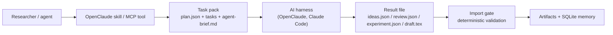

# PaperAssist

<p align="center">
  
  
</p>

PaperAssist is a model-free research runtime and an OpenClaude / Claude Code
plugin. It plans research, defines controlled experiments, prepares LaTeX
writing tasks, reviews manuscripts and verifies releases — while **the only
language model is the AI harness you already run**. PaperAssist ships no
provider client, no API key handling and no model selection.

> ⚠️ Disclaimer: this project is for learning and research. Do not use it
> commercially. You are responsible for anything you produce with it.

## Contents

- [What changed in v4](#what-changed-in-v4)
- [How it works](#how-it-works)
- [Install as OpenClaude plugin](#install-as-openclaude-plugin)
- [Using the plugin](#using-the-plugin)
- [Writing a paper: AI Harness &rarr; Paper-Assist](#writing-a-paper-ai-harness--paper-assist)
- [Skills included](#skills-included)
- [Workspace layout](#workspace-layout)
- [Scientific integrity](#scientific-integrity)
- [License](#license)

## What changed in v4

| Area | v3 | v4 |
|---|---|---|
| Language model | Bundled OpenAI-compatible client, provider registry, credentials | None. The AI harness is the executor (`provider_calls: 0`) |
| Generation | In-process agent runtime called the model | Deterministic task packs the harness executes |
| Integration | Custom CLI only | OpenClaude plugin with skills and an MCP server |
| Runtime | `ResearchOSRuntime` orchestrated agents | Pack → harness → import gate *is* the runtime |
| Package | `paperforge` | `paperassist` |

## How it works



PaperAssist never generates text. It owns:

- **Planning**: packs, task lists, briefs, acceptance rules.
- **Binding**: protected experiment blocks, citations.
- **Verification**: citation keys, score ranges, artifact hashes, release gates.

## Install as OpenClaude plugin

Tambahkan ke direktori plugin user OpenClaude:

```bash
cp -r . /c/Users/<you>/.openclaude/plugins/paper-assist
```

Atau clone langsung:

```bash
git clone https://github.com/mahdyarief/paper-assist.git ~/.openclaude/plugins/paper-assist
```

Lalu aktifkan:

```bash
cd ~/.openclaude/plugins/paper-assist
python -m pip install -r requirements-core.txt
```

Verifikasi MCP server:

```bash
python mcp_servers/stdio.py
```

## Using the plugin

Plugin ini dideklarasikan oleh `.claude-plugin/plugin.json`. Skill dibaca
dari `skills/`, dan MCP server `paperassist` berada di
`mcp_servers/stdio.py` (JSON-RPC over stdio).

MCP tools (10):

| Group | Tools |
|---|---|
| `paperassist` | `harness_status`, `pack_scaffold`, `pack_plan`, `pack_task`, `pack_import` |
| `writing` | `writing_pack`, `writing_plan`, `writing_task`, `writing_import`, `writing_patch` |

## Writing a paper: AI Harness &rarr; Paper-Assist

PaperAssist bukan generator teks. Alurnya:

1. Harness memanggil `pack_scaffold` (ideation / experiment / review / writing).
2. Harness membaca `plan.json` + `agent-brief.md` + `tasks/*.json` dari pack.
3. Harness melakukan pekerjaan (ide, uji, review, draft LaTeX).
4. Hasil diimpor kembali lewat `pack_import` / `writing_import` — gate
   deterministik dijalankan sebelum catatan disimpan ke SQLite dan `.paperassist/`.

Contoh (dari harness/agent, bukan konsol CLI):

```text
# 1. Scaffold pack ideation
pack_scaffold { "workspace": "<ws>", "kind": "ideation", "topic": "...", "venue": "NeurIPS" }

# 2. Harness kerjakan task dari pack, lalu impor hasil
pack_import { "workspace": "<ws>", "run_id": "<id>", "import": "ideas.json" }

# 3. Writing pack untuk draft LaTeX
writing_pack   { "workspace": "<ws>", "topic": "...", "title": "..." }
writing_import { "workspace": "<ws>", "run_id": "<id>", "import": "draft.tex" }
```

> Catatan: tool `pack_scaffold`, `pack_task`, `pack_import`, `writing_pack`,
> `writing_import`, dst. dipanggil assistant (OpenClaude / Claude Code)
> melalui MCP server `paperassist` yang sudah aktif sebagai plugin.

## Skills included

| Skill | Purpose |
|---|---|
| `write-section` | Draft one section without taking over the pipeline |
| `refine-section` | Tighten logic/wording/structure in one section |
| `citation-gap` | Find the single most important missing citation |
| `citation-select` | Pick references that best fit the manuscript |
| `de-aigc-rewrite` | Remove templated AI tone without changing the argument |
| `latex-fix` | Apply one local LaTeX repair round |

## Workspace layout

```text
<workspace>/
├── .paperassist/
│   ├── paperassist.db          # workflows, claims, evidence, artifacts
│   ├── packs/<kind>/<run-id>/  # plan.json, agent-brief.md, tasks/, target
│   ├── ideation/<run-id>/      # validated ideas.json
│   ├── experiments/<run-id>/   # validated result.json
│   ├── review/<run-id>/        # validated review.json
│   ├── publication/
│   └── release_manifest.json
├── artifacts/
├── main.tex
└── references.bib
```

## Scientific integrity

- No invented metrics, datasets, baselines, hardware or citations.
- Every quantitative claim must trace to a run, artifact or bibliography entry.
- Protected experiment blocks are author-owned and byte-preserved.
- Secrets are rejected at input, never written into a workspace.

## License

MIT. See [LICENSE](LICENSE).
